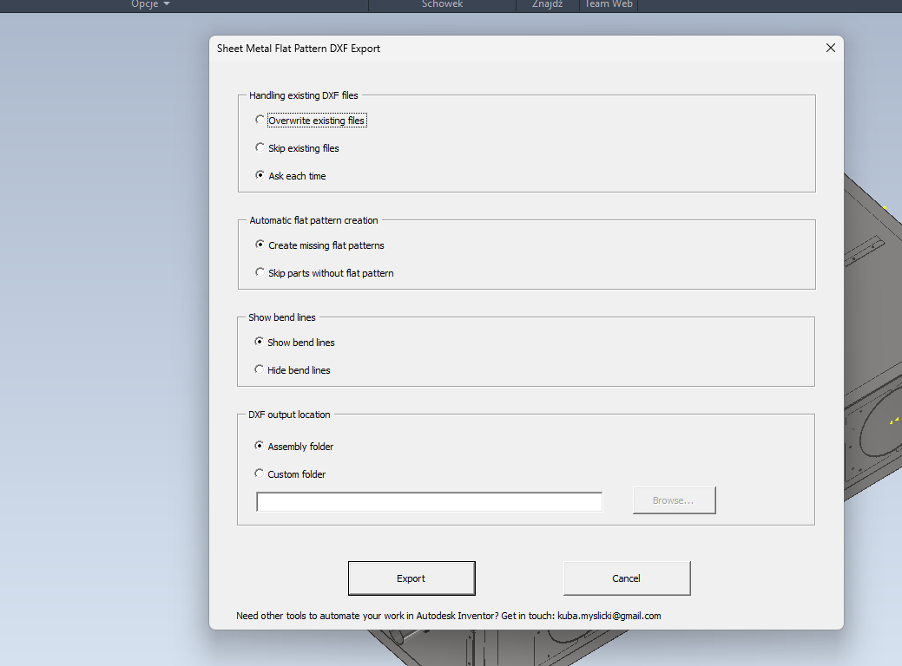
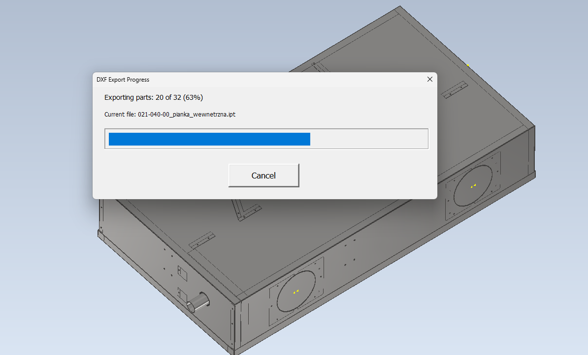

# Sheet Metal DXF Export

**Automated sheet metal flat pattern DXF export for Autodesk Inventor 2026.**

A VBA macro designed to simplify DXF export from assemblies and subassemblies.

## Features

The macro automatically detects sheet metal parts, creates missing flat patterns and exports unique parts to DXF files. It provides control over existing files, bend line visibility, output location and export progress.

## Screenshots

### Export Settings

### Export Progress

## Downloads

- **Polish version:** [Eksport blach do DXF – PL](../../releases)
- **English version:** [Sheet Metal DXF Export – EN](../../releases)

## Requirements

- Autodesk Inventor 2026
- VBA macro support

## License

Free for personal and commercial use under the included proprietary license. Modification and redistribution are not permitted.

## Contact

Need other tools to automate your work in Autodesk Inventor?

**kuba.myslicki@gmail.com**
